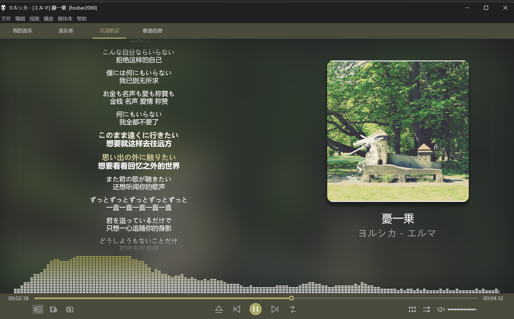
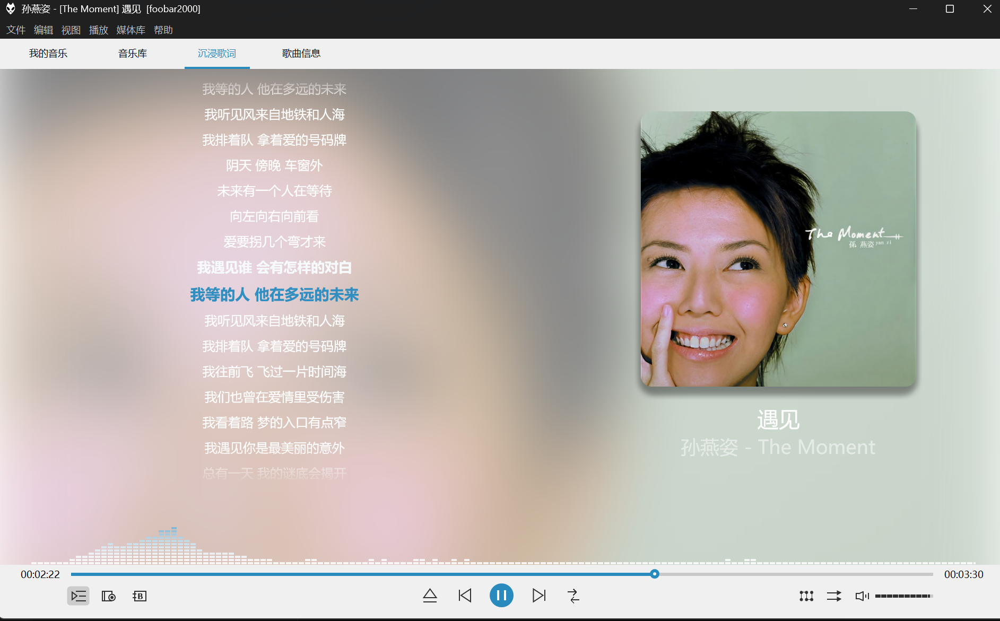
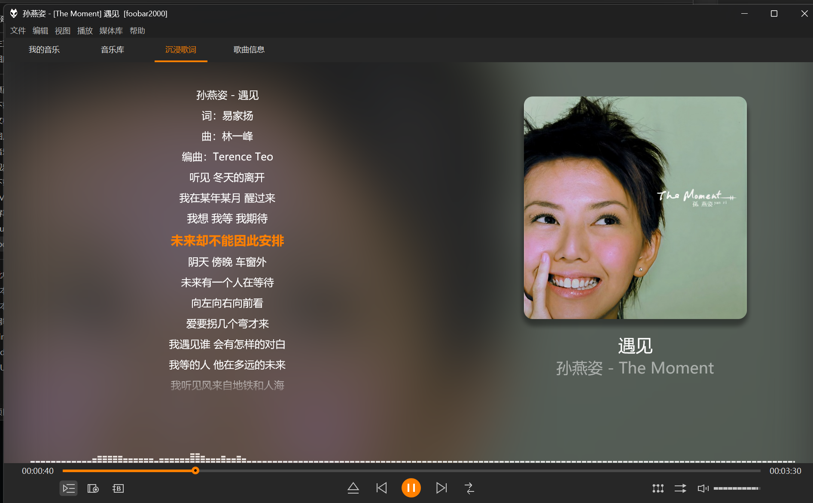
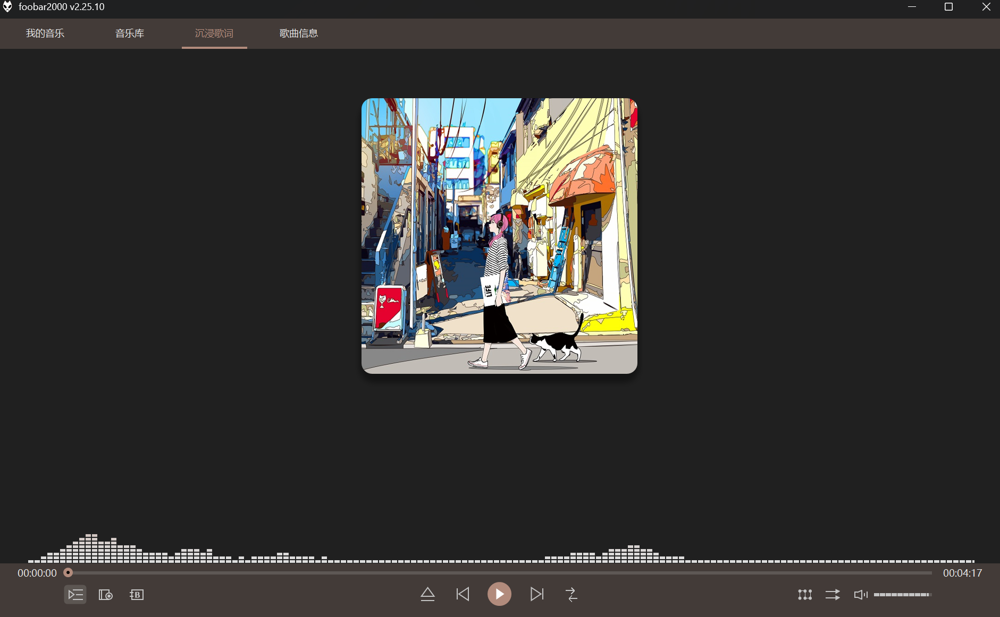
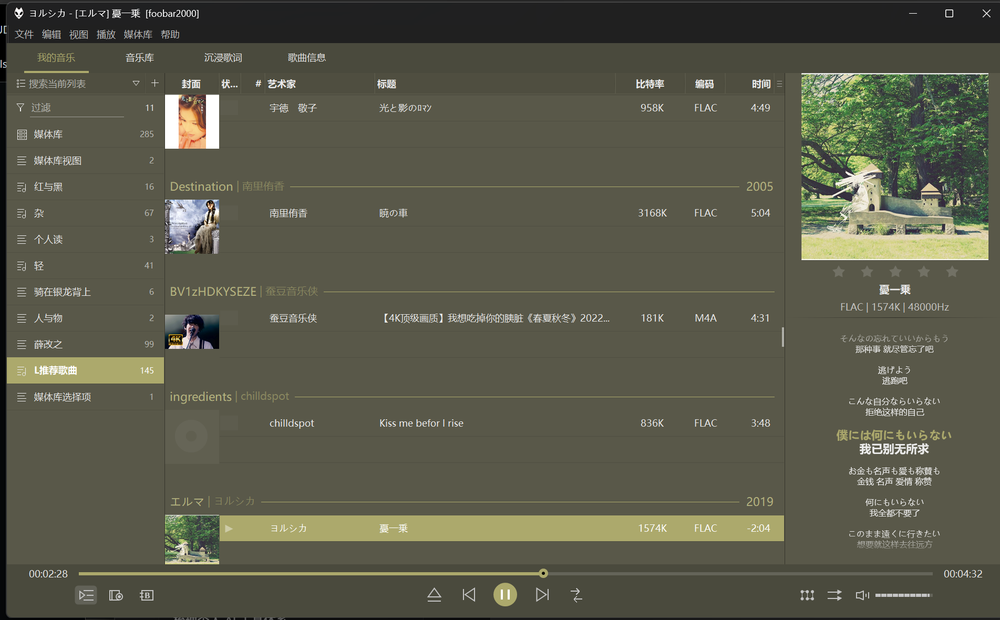
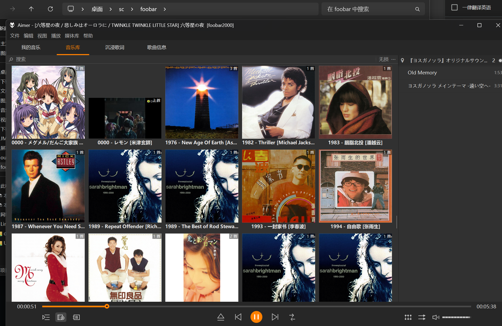
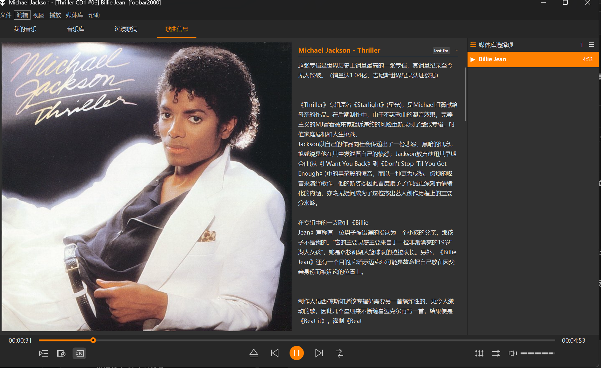

# Foobar Immersive · 沉浸听歌

基于 [foobox-cn](https://github.com/dream7180/foobox-cn) 的个人界面改造：四个主页面、左歌词右封面、模糊封面背景、随封面变色的频谱，以及深浅配色。新安装默认使用深灰橙色，可手动切换浅色。

**这是主题源码覆盖层，需要先安装兼容的 foobox；不包含 foobar2000 主程序、组件 DLL、歌曲或第三方整合包。**

## 界面预览

左边看歌词，右边看封面，让本地音乐也有一个适合专心听歌的界面。



> 以下为个人配置实机截图，展示改造方向。公开仓库是源码覆盖层，截图中的部分第三方素材、阴影与配置未包含在发布包内；安装后效果取决于原有 foobox 布局、组件、封面和歌词。歌曲封面、歌词及简介内容归相应权利人所有，截图仅用于界面演示，不代表音乐资源随项目提供。

### 深浅配色

同一首《遇见》的深浅模式对比。截图中的高亮色为实机设置示例，公开包提供独立定义的深灰橙色与浅色配色。

| 浅色模式 | 深色模式 |
| --- | --- |
|  |  |

点击图片可查看原图。

### 默认封面预览

未播放或没有歌曲封面时，可显示自定义默认插画。下面是本机使用“耳机少女与猫”素材的深色界面示例；截图中的频谱仅展示拍摄时的界面状态。



插画参考自 HDVN10 音效版中的 `NoBack.png`，分享者为得闲饮茶吃个包，来源见 [参考与署名](ATTRIBUTION.md)。原画作者尚未确认；该默认图仅用于本机配置及此处界面展示，公开覆盖包不包含这张插画，也不会自动安装该默认图。
### 四个主页面

| 页面 | 用途 |
| --- | --- |
| 我的音乐 | 播放列表、歌曲信息与侧边歌词，适合日常选歌。 |
| 音乐库 | 按专辑封面浏览本地收藏。 |
| 沉浸歌词 | 左侧滚动歌词、右侧封面，底部显示实时频谱。 |
| 歌曲信息 | 查看艺术家或专辑简介，需要原布局提供 Biography 及相应内容来源。 |

<details>
<summary>展开查看：我的音乐、音乐库、歌曲信息</summary>

#### 我的音乐



#### 音乐库



#### 歌曲信息



</details>

## 功能

- 顶部切换“我的音乐 / 音乐库 / 沉浸歌词 / 歌曲信息”；简介页面在原布局提供 Biography 时显示。
- 沉浸页展开歌词区域，显示左侧歌词、右侧封面和底部 ESLyric 内置频谱。
- 进度条保留普通拖动定位；频谱显示在进度条上方，不是整首歌曲的静态波形。
- 频谱沿用 foobox 提取的封面强调色，并调整暗色强调色的可读性。
- 两份仅颜色的 `.fth`，可通过 foobar 原生导入切换，避免覆盖页面布局。
- 移除独立可视化页面的脚本入口；ESLyric 内置频谱保留。

## 安装

### 第一次安装，从这里开始

想从零安装，请阅读 **[新手安装：从下载到沉浸歌词](docs/BEGINNER.md)**。教程按具体文件、安装步骤、歌词与配色设置逐步说明；本轮固定使用 **foobox 8.8 默认布局 + JSplitter 4.3.4 + ESLyric 1.0.6.2**；安装文件、布局依赖和实际复制已核验，完整视觉验收仍在进行。不要直接用最新 foobox 8.14。

### 下载入口与安装顺序

1. **播放器**：中文用户可从 [Asion 汉化版作者发布页](https://www.cnblogs.com/asionwu/p/21537446) 获取安装资源；本机已使用版本为 **foobar2000 v2.25.10 x64**，这不代表其他版本已经验证。原版请到 [foobar2000 官方下载页](https://www.foobar2000.org/download) 获取。汉化与主程序归原作者，本项目不重新上传汉化安装程序。
2. **foobox 基础主题**：从 [foobox 8.8 发布页](https://github.com/dream7180/foobox-cn/releases/tag/8.8) 下载 `foobox_x64.cn.v8.8-1.exe`，再按新手教程更新 JSplitter 和 ESLyric。当前覆盖层不兼容 8.14 的根脚本结构。
3. **本项目覆盖层**：当前下载 [源码 ZIP](https://github.com/konghenfuxue-cpu/foobar-immersive/archive/refs/heads/main.zip)，解压后按下方说明运行 `Install.ps1`。这是需要现有 foobox 的主题覆盖层，不是解压即用的播放器。

**发布状态（2026-10-18）**：尚未提供主题安装器 EXE 或独立 Release 资源包。后续资源包将在 [本项目 Releases](https://github.com/konghenfuxue-cpu/foobar-immersive/releases) 提供；当前不要把该页面当成已有安装包下载入口。计划以主题配置安装包交付，播放器仍从上述来源获取；第三方组件按各自许可决定能否打包。托盘优化仍在本机测试，存在首次恢复页面空白的反馈，不能据此承诺固定内存占用或已解决恢复问题。

先阅读 [安装与使用](docs/INSTALL.md)。本机改造基线为 Windows、foobar2000 2.25.3 x64、foobox DUI、JSplitter 4.0.4.4-beta、ESLyric 1.0.6.2 Beta。其他 foobox 版本需核对面板名称与脚本入口。

2026-10-12 已通过用户“关于”截图确认主程序升级为 **foobar2000 2.25.10 x64 · Asion 汉化版**，来源为 [Asion 发布文章（2026-08-24 更新）](https://www.cnblogs.com/asionwu/p/21537446)。上述 2.25.3 是最初改造基线；主程序版本确认不等于全部组件已更新或长期稳定性验证完成。

```powershell
# 只检查，默认不写入。先关闭 foobar。
.\Install.ps1 -ProfilePath "$env:APPDATAoobar2000-v2"

# 确认输出的文件列表后应用覆盖层。
.\Install.ps1 -ProfilePath "$env:APPDATAoobar2000-v2" -Apply
```

安装默认应用深灰橙色，仅替换颜色区段，保留现有布局和字体，并在配置目录保存原主题备份；已有用户要保留当前配色，可在安装命令末尾加 `-KeepColours`。

发布版歌词布局采用不带第三方图片的简洁实现。私人配置中的 foocolor 阴影图和默认封面没有打包，因此不会与私人截图逐像素相同。公开配色是独立定义的深灰橙色与浅色，不分发原作者的主题文件。

## 近期更新

### JSplitter 升级记录 · 2026-10-12

独立便携测试环境将 JSplitter 从 4.0.4.4-beta 升级到 **4.3.4 x64**；用户反馈持续播放正常后，已将相同组件文件迁入正式配置，主程序为 foobar2000 2.25.10 x64。正式版长期稳定性仍继续观察，不据此宣称历史崩溃已根治。升级方式及简介包注意事项见 [安装说明](docs/INSTALL.md#升级-jsplitter)。组件请从 [JSplitter 官方发布页](https://github.com/dima-lur/jsplitter/releases/tag/v4.3.4) 获取，本仓库不分发 DLL 或私人测试配置。

完整变化记录见 [CHANGELOG.md](CHANGELOG.md)。

## 来源与致谢

本项目属于配置整合与局部改造，不把参考主题称为原创成果。完整来源、参考版本、涉及文件与分发边界见 [ATTRIBUTION.md](ATTRIBUTION.md)。

特别致谢 **Asion、dream7180 / dreamawake、雾隐凝霜（锦瑟）、jk、隔壁老王66662、得闲饮茶吃个包、贴吧闲云哥**，以及各组件、脚本和汉化作者。

同期参考的整合包包括：**【闲云哥出品】2025-11-19 更新 foobar2000-v2.25.3[x86]-VIP 特别定制版**，由贴吧闲云哥分享。

## 文件

- `overlay/foobox/script/`：需要替换或增加的五份 JS 源码，保留上游署名。
- `overlay/eslyric-data/layout/`：公开版沉浸布局和日常歌词布局。
- `overlay/foobox/配色/`：独立颜色定义生成的深浅 `.fth`，不含布局。
- `Install.ps1`：默认只检查的安装入口。
- `docs/VALIDATION.md`：已验证内容与尚未验证的边界。

## 许可证

foobox 衍生脚本遵循 **GPL-3.0**，本项目新增代码也按 GPL-3.0 发布，见 [LICENSE](LICENSE)。第三方软件及参考主题的权利归各自作者；本仓库许可证不替他们授权。
