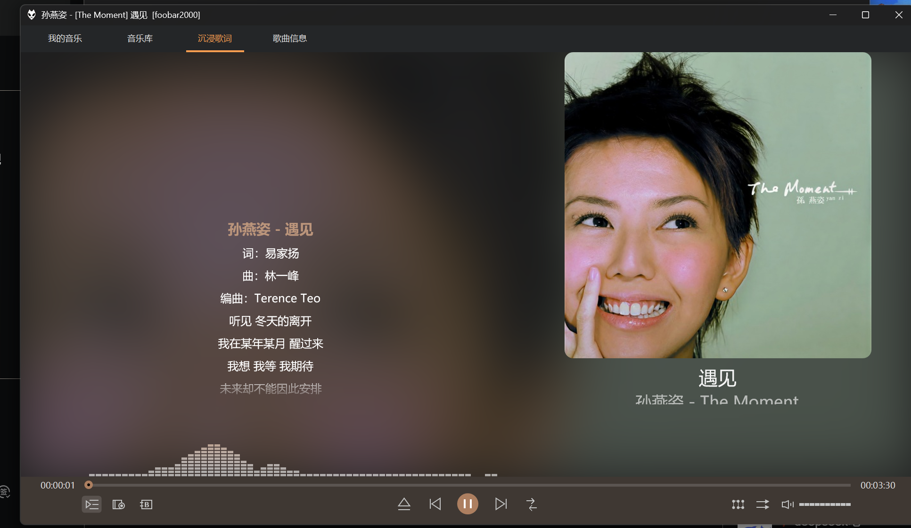
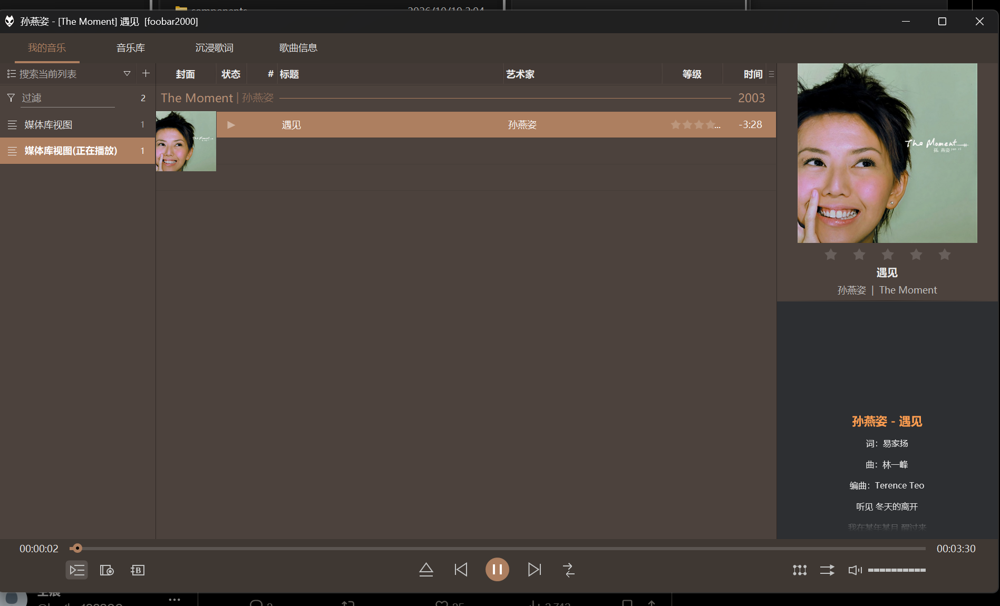

# Foobar Immersive · 沉浸听歌

让本地音乐拥有左歌词、右封面与实时频谱。

### [下载离线正式版 →](https://github.com/konghenfuxue-cpu/foobar-immersive/releases/latest)

**Windows x64** · 中文安装助手 · 默认深色 · 自动备份配置

[新手教程](docs/BEGINNER.md) · [常见问题](#常见问题) · **[问题反馈](https://github.com/konghenfuxue-cpu/foobar-immersive/issues/new/choose)** · [更新记录](CHANGELOG.md)

下载 Releases 中名称含 **offline** 的 ZIP，解压后双击 **一键安装.cmd**。安装包已包含主题和所需组件，**foobar2000 播放器需单独安装**。

## 实际效果

新装播放器的实测画面：左边看歌词，右边看封面，模糊背景与频谱随音乐变化。

查看日常选歌界面：播放列表、封面与侧栏歌词

截图中的歌曲、封面与歌词仅用于演示，权利归相应权利人所有；安装包不附带音乐或私人音乐库。

## 三步开始使用

| 步骤 | 操作 |
| --- | --- |
| **1 · 准备播放器** | 已有 x64 播放器可直接进入下一步。首次安装请从 [Asion 作者页](https://www.cnblogs.com/asionwu/p/21537446) 获取普通 x64 汉化版，或使用 [官方原版](https://www.foobar2000.org/download)。本轮验证版本为 2.25.10 x64。 |
| **2 · 安装主题** | 退出播放器，下载 [离线正式版](https://github.com/konghenfuxue-cpu/foobar-immersive/releases/latest)，全部提取后双击 **一键安装.cmd**，按中文提示操作。 |
| **3 · 添加歌曲** | 启动播放器，将自己的歌曲拖入即可播放。要管理整个音乐文件夹，到 `Ctrl+P → 媒体库` 添加目录。 |

**安装位置只记一条：选择这次要使用的 `foobar2000.exe` 所在文件夹，不要选 `profile`。** foobox 安装窗口可能自动找到另一套播放器，继续前请确认路径。首次安装仍需完成上游向导，详细选项见 [图文步骤与备份恢复](docs/BEGINNER.md)。

## 能做什么

| 页面 | 用途 |
| --- | --- |
| **我的音乐** | 日常选歌：播放列表、专辑封面和侧栏歌词。 |
| **音乐库** | 按专辑封面浏览收藏，可使用播放列表或媒体库数据源。 |
| **沉浸歌词** | 左歌词、右封面、模糊背景和随封面变色的实时频谱。 |
| **歌曲信息** | 查看 Biography 艺术家或专辑资料，在线内容取决于来源是否可用。 |

支持深浅配色，安装默认深灰橙色；封面强调色可随歌曲变化。进度条可拖动定位，底部频谱显示当前声音，不是整首歌的静态波形。

更多界面：音乐库、深浅配色和个人默认插画

| 浅色示例 | 深色示例 |
| --- | --- |
|  |  |

以下为个人配置的默认插画展示，**该插画不随公开安装包提供**，安装后不会自动出现。

插画参考自 HDVN10 音效版的 `NoBack.png`，分享者为得闲饮茶吃个包，原画作者尚未确认。私人阴影等素材同样不打包。来源见 [ATTRIBUTION.md](ATTRIBUTION.md)。

## 常见问题

下载哪个文件？Source code 能直接安装吗？

到 [最新正式发布](https://github.com/konghenfuxue-cpu/foobar-immersive/releases/latest) 的 Assets 下载名称含 **offline** 的 ZIP。GitHub 自动生成的 Source code 仅包含源码，没有离线依赖。不要在压缩包预览里直接运行，先“全部提取”。

还要单独下载主题和两个组件吗？

不用。离线包包含固定的 **foobox 8.8、JSplitter 4.3.4、ESLyric 1.0.6.2** 原包，助手校验后使用。播放器主程序另行安装。当前不要用 foobox 8.14 替代，布局结构不同。依赖来源和分发说明见 [离线依赖说明](docs/OFFLINE-DEPENDENCIES.md)。

能缩到右下角托盘继续播放吗？

到 `Ctrl+P → 显示 → 默认用户界面 → 后台与通知`，选择“最小化：隐藏到系统托盘，关闭：退出”。点窗口“—”隐藏，从右下角托盘图标恢复。这项需手动开启。

停止播放后沉浸页空白，是出错了吗？

停止或刚启动尚未播放时没有当前播放音轨，沉浸页可能没有歌词与封面；开始播放后显示。真正暂停与停止不同。没有封面或歌词时，先检查歌曲内嵌封面和歌词来源，本主题不会自动补齐整库资料。

会覆盖我的音乐或现有配置吗？

助手不修改歌曲文件。安装前会备份播放器配置，之后更新同名主题脚本、组件并应用默认深色；已有个人布局请先看 [完整安装说明](docs/INSTALL.md)。测试另一套播放器时务必确认目标目录。

## 近期更新 · 2026-10-19

- 提供中文离线安装助手和正式版下载入口。
- 修复 PowerShell 5.1 安装错误、首次歌词白底与布局未启用。
- 修复冷启动列表和封面偶发空白。
- 本轮用户已逐步验证首次安装、主要界面效果和托盘恢复；长期稳定性、其他屏幕尺寸及全新操作系统仍需观察。

[完整变化记录](CHANGELOG.md) · [验证范围](docs/VALIDATION.md)

公开包未包含仍在本机测试的托盘内存优化，不承诺固定内存值。
## 问题反馈

遇到安装失败、页面空白或其他异常，请到 **[GitHub Issues 提交反馈](https://github.com/konghenfuxue-cpu/foobar-immersive/issues/new/choose)**。先查看 [已有反馈](https://github.com/konghenfuxue-cpu/foobar-immersive/issues)，同一问题可直接补充。

模板会提示填写安装包与播放器版本、操作步骤、播放状态和报错截图。上传前请遮住用户名、私人路径和其他敏感信息，不要上传音乐文件或整个私人配置。

## 来源与致谢

本项目属于配置整合与局部改造，不把参考主题称为原创成果。完整来源、参考版本、涉及文件与分发边界见 [ATTRIBUTION.md](ATTRIBUTION.md)。

特别致谢 **Asion、dream7180 / dreamawake、雾隐凝霜（锦瑟）、jk、隔壁老王66662、得闲饮茶吃个包、贴吧闲云哥**，以及各组件、脚本和汉化作者。

同期参考的整合包包括：**【闲云哥出品】2025-11-19 更新 foobar2000-v2.25.3[x86]-VIP 特别定制版**，由贴吧闲云哥分享。

## 文件与许可证

- `Setup.ps1`、`一键安装.cmd`：中文安装助手。
- `Install.ps1`：默认只检查的覆盖层安装器。
- `overlay/`：五份 JS 脚本、公开歌词布局及只含颜色的主题文件。
- `docs/`：安装教程、来源说明、截图和验证记录。

foobox 衍生脚本及本项目新增代码按 **GPL-3.0** 发布，见 [LICENSE](LICENSE)。第三方软件与素材的权利归各自作者，本仓库许可证不替他们授权。
