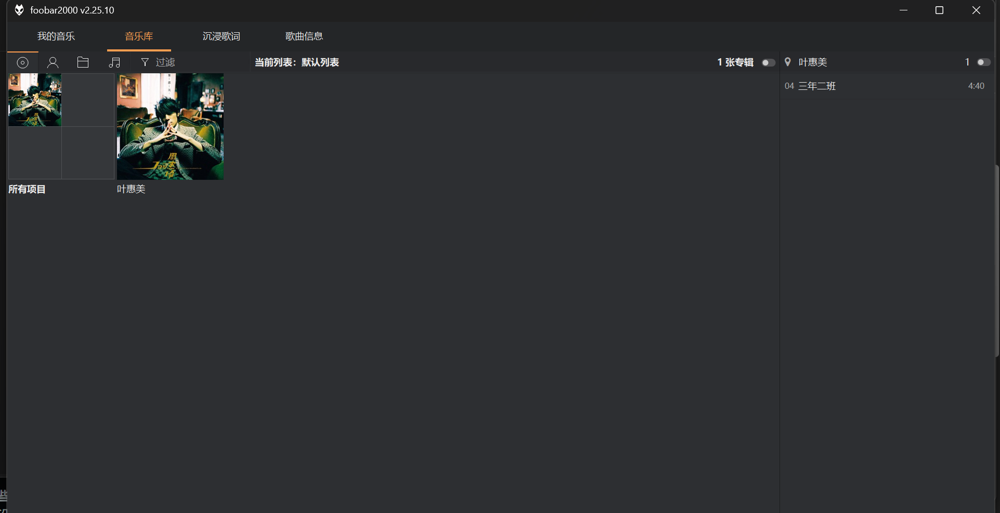

# 新手安装：从下载到沉浸歌词

目标界面是顶部四个页面、左歌词右封面、封面模糊背景和底部频谱。以下按 Windows x64、首次安装说明。已有个人配置的用户先备份，再看 [完整安装说明](INSTALL.md)。

> 当前是手动安装教程，不是“全新电脑照做后已验证得到同款”的承诺。本轮已核对 foobox 8.8 默认布局包含所需面板，需按以下固定版本组合安装；本机独立配置已取得四页显示截图及默认深色确认，本轮首次安装已由用户逐步验证，长期稳定性仍需观察。作者的私人截图也包含公开包不提供的素材。遇到下面的布局检查不通过，应停止覆盖，不要求新手自行改脚本。

## 简便入口：中文安装助手（预览）

推荐到 [Releases](https://github.com/konghenfuxue-cpu/foobar-immersive/releases) 下载名称含 **offline** 的离线包。它已包含 foobox、ESLyric 和 JSplitter 原包，解压后双击 **一键安装.cmd**，安装主题与组件无需重复联网下载；播放器仍需单独安装。

下载并解压本项目 ZIP，双击根目录的 **`一键安装.cmd`**。无需复制命令。助手会识别常见播放器目录；自定义位置只需粘贴一次安装文件夹路径。

助手会备份并校验现有配置，下载固定的 foobox 8.8、ESLyric 1.0.6.2 和 JSplitter 4.3.4，保留原有脚本包，应用四页主题与默认深色。已有兼容 foobox 时跳过基础主题安装。

还没装播放器时，助手打开 Asion 来源页，请安装普通 x64 版；foobox 首次安装仍会显示上游安装向导，按助手提示完成。下载需要能连接 GitHub。已有不兼容主题时会停止，不自动重置个人配置。

此入口为预览：已验证备份、路径与组件解包，尚待用户在桌面完成整套向导验收。失败时保留窗口中的提示；完整备份位于原配置文件夹旁边，以 `.before-immersive-时间` 结尾。以下手动流程作为备用。

## 1. 下载并安装播放器

打开 [Asion 汉化版发布页](https://www.cnblogs.com/asionwu/p/21537446)，下拉到“下载地址”，选择作者提供的网盘。在网盘中找文件名包含 `x64`、不包含 `Plus` 的普通汉化版安装程序；作者本机使用的是 `FB_2.25.10_x64_Asion_20260824150803.exe`。文件名中的时间可能随作者更新变化，不要下载 x86 版，也不要给安装程序改名。

本文采用普通版加单独安装 foobox 的路径。Plus 版已经集成其他界面配置，不能把两种路径混着覆盖。网盘入口与版本以作者发布页为准；来源：Asion。

运行下载的 EXE，按安装向导操作。首次安装可使用默认目录；记住安装位置。若有“标准模式 / 便携模式”，本文后续命令按标准模式说明。音频格式组件按需要选择，不为了本主题安装全部音效或输出组件。不要对已有播放器执行重置配置。

安装后打开播放器，在“帮助 → 关于”确认显示 `x64`。先将一首自己的本地歌曲拖入，确认能播放，再退出播放器。也可从 [foobar2000 官网](https://www.foobar2000.org/download) 获取原版；原版不是中文界面，本文中文菜单可能不同。

## 2. 下载并安装 foobox 基础主题

打开 [foobox 8.8 发布页](https://github.com/dream7180/foobox-cn/releases/tag/8.8)，展开 **Assets**，选择 **`foobox_x64.cn.v8.8-1.exe`**，不要选 x86，也不要把 `Source code` 当作主题安装器。2026-10-18 已下载并核验该文件的官方 SHA-256，解包确认默认布局的面板和脚本入口匹配。不要选最新 8.14：其根脚本及分栏结构已经改变，当前覆盖层不兼容。

完全退出 foobar 后运行这个安装程序，根据上游提示选择实际播放器及配置位置。目录含义不明确时先查看安装程序说明，不凭猜测把它装进任意新文件夹。

完成后打开 foobar，确认出现 foobox 播放列表和封面界面，歌曲仍能播放。此时没有本项目的四个标签属于正常：还没有安装本项目覆盖层。

## 安装覆盖层前，先更新两个组件

foobox 8.8 的布局匹配，但自带 ESLyric 0.5.4 与 JSplitter 4.0.4.4，版本过旧。只装基础主题还不够，继续完成以下步骤：

1. 到 [ESLyric 1.0.6.2 发布页](https://github.com/ESLyric/release/releases/tag/1.0.6.2)，在 Assets 中下载 `foo_uie_eslyric_1.0.6.2.fb2k-component`。
2. 到 [JSplitter 4.3.4 发布页](https://github.com/dima-lur/jsplitter/releases/tag/v4.3.4)，在 Assets 中下载 `foo_uie_jsplitter_4.3.4.fb2k-component`，不是 `_RU` 版本。
3. 打开 foobar“文件 → 首选项 → 组件”，点击“安装”，选择下载的组件文件。按提示应用并重启；两个都装完后再次检查。
4. 在组件列表确认 ESLyric 为 **1.0.6.2**、JSplitter 为 **4.3.4**。如果出现简介 `Package not found`，按 [升级 JSplitter](INSTALL.md#升级-jsplitter) 保留原有脚本包，不能直接删除整个组件目录后重装。

组件文件供播放器安装，不要双击后用压缩软件打开，也不要将 x86 DLL 手工覆盖到 x64 目录。其他版本的完整界面兼容性不在本轮结论内。
## 3. 下载本项目

点击 [下载 foobar-immersive 源码 ZIP](https://github.com/konghenfuxue-cpu/foobar-immersive/archive/refs/heads/main.zip)。在资源管理器中右键 ZIP，选择“全部提取”。打开解压后的文件夹，确认里面同时有：

- `Install.ps1`
- `manifest.json`
- `overlay` 文件夹

不要直接在压缩包预览窗口内运行脚本。当前提供双击 CMD 的中文安装助手，没有独立安装 EXE。

## 4. 检查配置，再安装覆盖层

先完全退出 foobar。在资源管理器地址栏输入 `%APPDATA%\foobar2000-v2` 并回车。标准安装通常使用这个目录；如果目录不存在，或里面没有 `foobox` 文件夹，不要创建空目录来绕过检查，应先确认 foobox 实际安装位置。

把整个配置文件夹复制到自己选定的备份位置。后面的脚本会覆盖同名文件，不自动建立完整回滚备份。

回到解压目录，在资源管理器地址栏输入 `powershell` 并回车，在打开的终端中执行：

```powershell
powershell -NoProfile -ExecutionPolicy Bypass -File .\Install.ps1 -ProfilePath "$env:APPDATA\foobar2000-v2"
```

这是只检查模式，不会改变任何文件。默认也会检查深色配色能否合并；只有看到 `No files changed` 且没有错误，才能继续：

```powershell
powershell -NoProfile -ExecutionPolicy Bypass -File .\Install.ps1 -ProfilePath "$env:APPDATA\foobar2000-v2" -Apply
```

安装后默认使用深灰底、浅色文字、橙色强调色。安装器只替换主题中的颜色区段，不覆盖主布局和字体；原主题自动备份为配置目录中的 `foobox-theme-before-dark-日期时间.fth`。已有用户如需保留当前配色，在上述命令末尾加 `-KeepColours`。完整配置仍需按前文自行备份。

检查通过只说明文件结构和包校验通过，不证明原生布局兼容。便携模式的配置路径不同，不能照抄上面的配置路径，见 [目录和安装](INSTALL.md#目录和安装)。

## 5. 打开播放器，检查页面

打开 foobar，正常应显示“我的音乐 / 音乐库 / 沉浸歌词 / 歌曲信息”；“歌曲信息”还需要原布局提供简介面板。

**如果没有这些标签，或出现面板缺失、空白，不要继续往面板里粘贴脚本。** 当前覆盖层沿用上述 foobox 8.8 的默认主布局，不自动转换其他布局；先确认没有误装 8.14 或导入其他布局主题。请保留错误信息，退出播放器并用第4步的备份恢复；这说明配置尚未匹配，不能以文件复制成功代替界面验收。

技术对应关系见 [布局兼容](INSTALL.md#布局兼容)。本轮已经核对 8.8 默认布局的面板依赖；如果要手工导入上游布局，使用该版本的“foobox8 + 简介.fth”，不要把只有颜色的 FTH 当作完整布局。

## 6. 启用沉浸歌词和深浅配色

在 ESLyric 歌词面板的设置中启用自定义布局，选择 **`FooboxImmersive`**。这是布局的内部名称，不是文件名。若列表中没有它，先核对第4步是否把 `overlay/eslyric-data/layout` 安装到实际配置目录。

本项目还需要 ESLyric 对外脚本控制接口。在“首选项 → 工具 → ESLyric → 高级选项”将 `pref.script.expose` 设为 `1`，然后重启。8.8 安装包也提供组件目录中的 `enable_script_control` 空文件；本轮已确认存在。两种方式都来自 [ESLyric 官方接口说明](https://github.com/ESLyric/release/wiki/外部JS面板控制接口)，不是要求同时重复设置。

随后点击顶部“沉浸歌词”。新安装默认就是深色，无需额外导入。以后希望切换深浅配色时，打开“首选项 → 显示 → 默认用户界面 → 导入主题”，选实际配置目录下的 `foobox/配色/深色-仅颜色.fth` 或 `浅色-仅颜色.fth`。

## 7. 添加自己的音乐，检查效果

先用一首有完整内嵌封面、歌曲标签、可用歌词的歌曲测试。可先直接拖入播放器；批量管理再到“首选项 → 媒体库”添加自己的音乐文件夹。本项目不附带音乐，也不会自动补齐整库的封面、歌词和双语翻译。

正常目标：四页面可切换；沉浸页左侧歌词、右侧封面；播放时有底部频谱；进度条可拖动；深浅配色可切换。没有歌词先检查歌词来源，没有封面先检查歌曲是否有封面，不要立刻重装主题。

### 音乐库空白时，先检查数据源

把歌曲拖到“我的音乐”只会加入播放列表，不等于已经把它所在文件夹加入媒体库。按 `Ctrl+P` 打开首选项，选择“媒体库”，添加自己的音乐文件夹，等待扫描完成。第一次可只加一个小文件夹，确认能识别后再导入更多音乐。

音乐库页上方如果写着“当前列表：默认列表”，它此时只浏览这个播放列表中的专辑；没有显示整个硬盘的收藏，不等于文件丢失。先将测试曲目加入该列表，确认封面可见，再按所用浏览器的设置选择媒体库数据源。不同上游浏览器版本的菜单可能不同，不用删除音乐或反复重装来尝试。

下图来自本轮独立配置：默认深色下可以显示《叶惠美》的专辑封面，并在右侧列出曲目。截图的数据源是当前播放列表，不是全媒体库扫描完成的证明。



### 歌曲信息页显示默认唱片时

“我的音乐”和“沉浸歌词”显示的是歌曲封面；歌曲信息页使用的 Biography 包默认选择艺术家视图，图片来源不同。该视图没有可用的艺术家照片时可能显示占位唱片，即使歌曲本身有内嵌封面。不要因此反复给歌曲写封面。

用户截图已确认歌曲信息页能显示标题、歌词内容和右侧列表；这不代表在线艺术家照片、人物介绍或专辑评论一定可获取。网络服务无内容时，本主题也不会凭空补出相关资料。

默认插画、私人阴影素材不随包提供，因此不能要求与作者所有截图逐像素相同。托盘内存优化还在本机测试，没有随公开覆盖层发布，也不承诺固定内存值。

## 托盘播放与停止时的显示

按 `Ctrl+P → 显示 → 默认用户界面 → 后台与通知`，选择“最小化：隐藏到系统托盘，关闭：退出”，点确定。播放时点击右上角“—”进入托盘；关闭按钮仍然退出。该设置不是主题安装器默认写入的选项。

暂停时仍有当前音轨；停止或刚启动未播放时，进度显示 `00:00 / 00:00`，沉浸页可能没有歌词与封面，开始播放后出现。这不等于歌曲缺封面。播放列表仍应正常显示；如果启动后列表也为空且切页才能恢复，请使用包含启动显示修复的新安装包。

## 本轮实际验收范围

2026-10-19，用户从普通 x64 汉化播放器开始，在新建便携配置安装 foobox 8.8，再应用本项目。修复首次歌词控制初始化和启动子面板可见性后，用户确认界面正常；播放中的封面、歌词、沉浸布局、频谱，以及手动启用托盘后的恢复已取得反馈。

本轮不是全新 Windows 系统或所有分辨率的验证，也不代表长期稳定性和固定内存占用保证。安装仍包含上游向导：foobox 的目标目录必须选本次播放器所在文件夹，不能照用它自动找到的另一套播放器目录。完整记录见 [验证记录](VALIDATION.md)。
